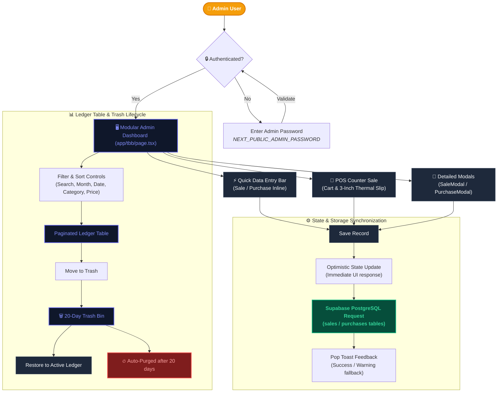

<div align="center">
  
  
  <h1>🥐 The Baker Bro — Financial Ledger, POS & Bakery Management System</h1>
  
  <p><b>A high-performance, real-time dual Sales & Purchase management system with 3-Inch Thermal POS, Supabase synchronization, auto-purging Trash recovery, and Indian Numbering System formatting.</b></p>

  <p>
    
    
    
    
    
    
    
  </p>
</div>

---

## 🌟 Key Features

- **🧾 Royal POS Counter & 3-Inch Thermal Printing**: Touch-friendly bakery POS with fast cart interactions, custom dynamic product sizing by sales volume, instant bill numbering (`POS-YYMMDD-XXX`), today's bill history, and direct 80mm thermal receipt printing window.
- **🏷️ Product & Price Register**: In-app catalog register to update default prices, add custom items, or remove products with live synchronization to the POS counter.
- **⚡ Always-Active Quick Data Entry Bar**: Rapid sales or purchase entry without modal friction, featuring mode switching (`Sale` / `Purchase`), live total calculation, auto-suggestions, and non-blocking background saving states (`⏳ Saving...`).
- **📊 Real-time Financial Metrics & Breakdowns**: Real-time calculation of Total Revenue (Sales), Total Expenses (Purchases), and Net Profit formatted in the **Indian Numbering System** (`₹1,00,00,000`), with detailed Payment Method and Category breakdowns.
- **📅 Dual Timestamping System**:
  - **`TXN DATE`**: Custom date selector for recording past or future transaction dates.
  - **`ENTRY CREATED`**: Immutable system creation timestamp showing exact date & time (`DD-MMM-YYYY, hh:mm AM/PM`) recorded in the database.
- **🔍 Advanced Multi-Filter & Search Engine**: Instant search across item names, bills, parties, notes, quick month selector, date range picker, category filter, supplier filter, payment mode/status filters, and min/max amount filters with active filter tags.
- **🔄 Interactive Column Sorting**: Sort table columns (`Type`, `Txn Date`, `Item`, `Category`, `Qty`, `Unit Rate`, `Total Amount`, `Status`, `Entry Created`) in ascending (`▲`) or descending (`▼`) order with one click.
- **🗑️ Trash Bin & Auto-Purging System**: Soft-delete entries safely into a dedicated Trash Bin with full **Restore** and **Permanent Erase** options. Entries are automatically purged after 20 days.
- **📦 Multi-Unit Support**: Native dropdown selectors for standard culinary and packaging units: `Pcs`, `KG`, `Grams`, `Packet`, `Unit`, `Litre`, `Box`.
- **📊 Multi-Sheet Excel Export**: Export clean Excel reports formatted in Indian currency format (`Sales Only`, `Purchases Only`, or `Both`).
- **🔐 Protected Admin Authentication**: Password protected dashboard session preventing unauthorized access.

---

## 🏗️ Technical Architecture & Modular Directory Structure

The application has been modularized into focused, reusable components adhering to clean code standards without altering core business logic:

```text
tbb/
├── app/
│   ├── globals.css                # Global styles, variables, typography & resets
│   ├── layout.tsx                 # Root layout with context providers
│   ├── page.tsx                   # Storefront landing page
│   ├── about/                     # About Us page
│   ├── contact/                   # Contact page
│   ├── customcakes/               # Custom cake ordering page
│   └── tbb/
│       └── page.tsx               # Admin Coordinator (State, Supabase Sync & Workflows)
├── components/
│   ├── admin/                     # Modular Admin Dashboard Components
│   │   ├── adminUtils.ts          # Pure utility helpers (currency, dates, note parsers)
│   │   ├── AdminAuth.tsx          # Password gatekeeper screen
│   │   ├── AdminHeader.tsx        # Top navigation, status indicator & header actions
│   │   ├── AdminAnalytics.tsx     # Revenue, expense, profit & breakdown cards
│   │   ├── QuickEntryBar.tsx      # Inline Sale & Purchase fast entry form
│   │   ├── AdminFilters.tsx       # Search, date range, month filter & advanced filter drawer
│   │   ├── AdminTable.tsx         # Unified ledger table, trash bin & pagination
│   │   └── modals/
│   │       ├── SaleModal.tsx          # Add / Edit Sale entry modal
│   │       ├── PurchaseModal.tsx      # Add / Edit Purchase entry modal
│   │       ├── DialogModals.tsx       # Delete confirmations, entry selector & export dialogs
│   │       ├── PosModal.tsx           # POS touch counter & thermal print view
│   │       └── PriceRegisterModal.tsx # Editable product & rate register
│   ├── baker/                     # Baker storefront views
│   ├── burger/                    # Burger & fast food storefront views
│   ├── AutoSuggestInput.tsx       # Floating auto-complete input
│   ├── CustomDatePicker.jsx       # Standardized date selector
│   ├── Navbar.tsx                 # Site navigation bar
│   └── Footer.tsx                 # Site footer
├── context/
│   ├── SiteContext.tsx            # Active brand state (Baker vs Burger)
│   └── supabase.ts                # Supabase client initialization
├── types/
│   └── admin.ts                   # TypeScript interfaces (SaleEntry, PurchaseEntry, TrashEntry)
├── utils/
│   └── excelExport.ts             # Excel (.xlsx) export utility
└── README.md                      # System documentation
```

---

## 📐 System Flow & Data Lifecycle



---

## 🚀 Getting Started

### 1. Installation
```bash
git clone <repository-url>
cd tbb
npm install
```

### 2. Environment Configuration
Create a `.env.local` file in the project root:
```env
NEXT_PUBLIC_ADMIN_PASSWORD=your_secure_password
NEXT_PUBLIC_SUPABASE_URL=your_supabase_project_url
NEXT_PUBLIC_SUPABASE_ANON_KEY=your_supabase_anon_key
```

### 3. Run Locally
```bash
npm run dev
```
Open [http://localhost:3000](http://localhost:3000) for the storefront or [http://localhost:3000/tbb](http://localhost:3000/tbb) for the Admin Dashboard.

### 4. Production Build Check
```bash
npx tsc --noEmit
npm run build
```
